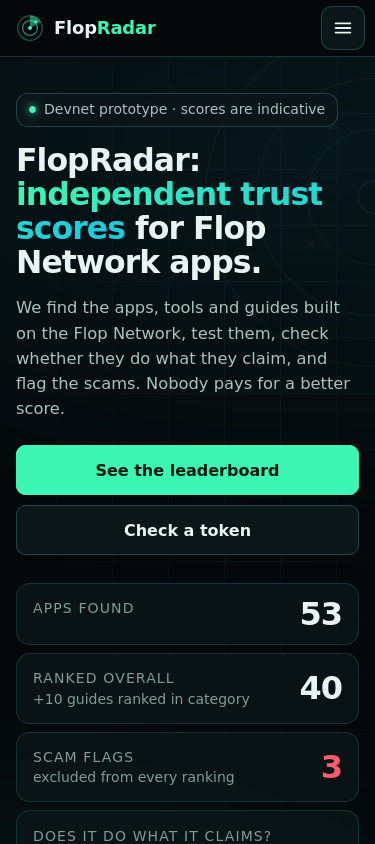

# FlopRadar

Independent trust scores for Flop Network apps. Live at **https://flopradar.com**.

FlopRadar finds the apps, tools and guides built on the Flop Network, tests them, checks whether each one does what it claims, and flags scams and fake FLOP tokens.

> Independent. Not affiliated with Flop Labs. Devnet prototype: scores are indicative. Nothing here is financial advice. FlopRadar never asks for a seed phrase or private key. No official FLOP token exists before mainnet/TGE.



## What's here

| Path | What it is |
|---|---|
| `site/public/` | The static site deployed to Cloudflare Pages (HTML/CSS/JS, no framework) |
| `site/build.sh`, `site/sanitize.py` | Builds the public data copy and fails on anything key-like or internal |
| `site/qa_functional.py`, `site/qa_mobile.py`, `site/check.py` | Headless QA: functional checks and overflow/tap-target checks at 320–1440 px |
| `site/redirect-trustflop/` | 301 redirect project for trustflop.com → flopradar.com |
| `data/leaderboard.json` | The published scores (also served at https://flopradar.com/data/leaderboard.json) |
| `scorer/score.mjs` | The scorer: probes, safety scan, claims deduction, ranking |
| `scorer/claims.json` | Claims-check verdicts per app, with notes and evidence |
| `scorer/candidates.json`, `testset.json`, `impersonators.json` | Discovered apps, the fixed test prompts, and the fake-token/lookalike list |
| `scorer/config.example.json` | Weights and endpoints; copy to `config.json` and point at your own key files |
| `docs/METHODOLOGY.md` | How scores are built |
| `docs/VOTING.md`, `voting-worker/` | Community-vote design (Cloudflare Worker + D1, not yet deployed) |

## How scoring works

Score = reliability 25% + quality 25% + safety 25% + speed 15% + cost 10%.
Claims check: "Partly" −5 quality, "Not verified" −15. High-severity safety flags exclude an app from ranking.
Community votes, when they open, are capped at 15% of a score (Wilson score, wallet-weighted).
**Payment never changes a score.** Any owner-requested audit is labelled as such.

## Run it

```bash
cd scorer && npm install
cp config.example.json config.json   # set your own key-file paths; never commit keys
node score.mjs                        # writes ../data/leaderboard.json

cd ../site && ./build.sh              # must print BUILD OK
npx wrangler pages deploy public --project-name flopradar --branch main
```

## Corrections

Think a score or verdict is wrong? Open an issue with the evidence. Every verdict links to what it was based on.

## License

MIT
